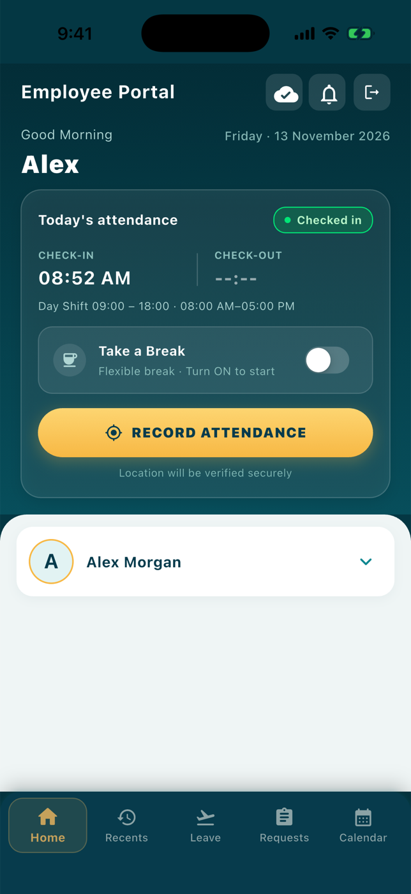
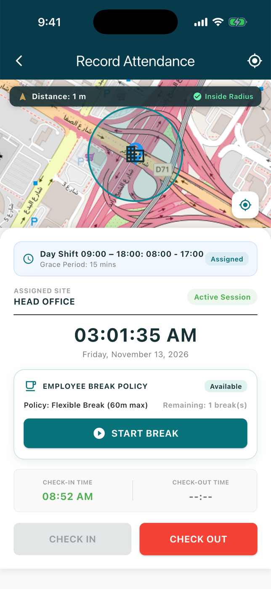
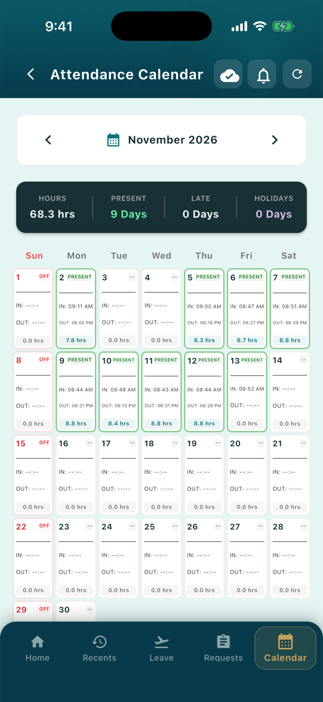
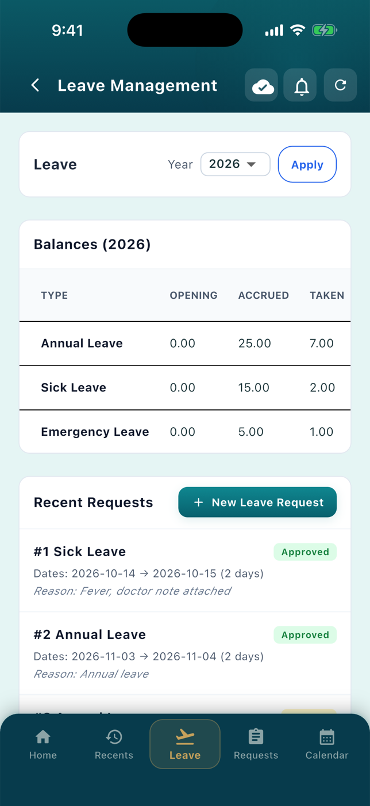
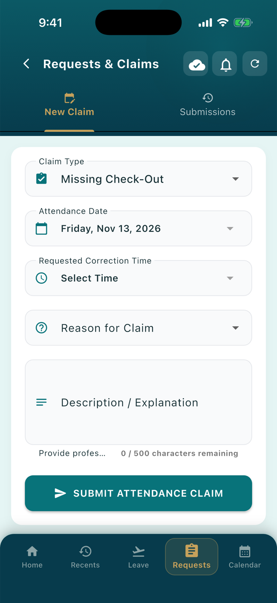
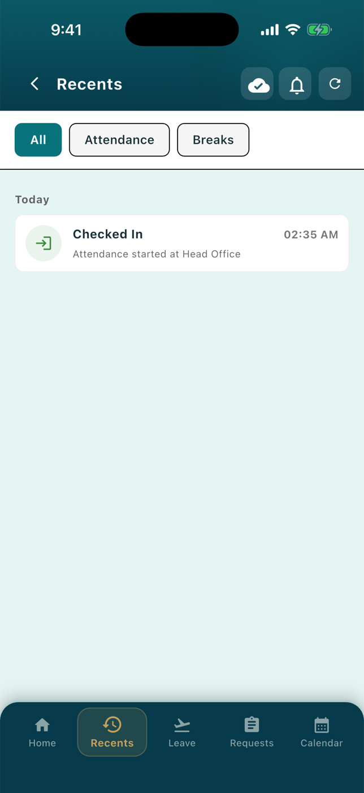
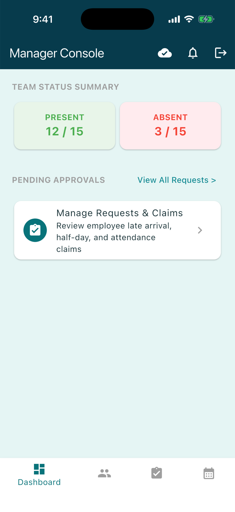

# HR Employee Self-Service App

A cross-platform Android and iOS app for employee attendance and HR self-service, with a Laravel REST API behind it. Staff check in and out by GPS, raise leave and correction requests, and get push notifications. Managers approve requests from the same app.

## Features

- **GPS attendance:** check-in, check-out and breaks, with location tracking for site and office staff
- **Offline mode:** attendance is stored locally in SQLite and synced when the connection returns
- **Leave and requests:** leave, attendance corrections and claims, with multi-level manager approval
- **Shifts and holidays:** shift schedules, break policies, holiday calendar and attendance policy settings
- **Maintenance and inventory:** maintenance requests, work orders and material requests for site teams
- **Push notifications:** sent through Firebase Cloud Messaging, with email alerts as well
- **Security:** Sanctum access tokens plus rotating refresh tokens, device binding with one-time activation codes, biometric unlock, and secure token storage
- **Compliance docs:** privacy, location, biometric and data-retention policies in `legal/`

## Screenshots

> Captured on the iOS Simulator against a local backend with demo data (made-up employees and attendance).

<table>
<tr>
<td align="center"><br><b>Home</b></td>
<td align="center"><br><b>GPS check-in / out</b></td>
<td align="center"><br><b>Attendance calendar</b></td>
</tr>
<tr>
<td align="center"><br><b>Leave balances & requests</b></td>
<td align="center"><br><b>Attendance claims</b></td>
<td align="center"><br><b>Recent activity</b></td>
</tr>
<tr>
<td align="center"><br><b>Manager console</b></td>
<td></td><td></td>
</tr>
</table>

## Tech

| Part | Stack |
|---|---|
| Mobile (`mobile/`) | Flutter, Dart, Riverpod, go_router, Dio, sqflite, Geolocator, flutter_map, Firebase Messaging, local_auth |
| Backend (`backend/`) | PHP 8, Laravel, Sanctum, MySQL, Firebase Admin SDK |

## Running locally

**Backend**
```bash
cd backend
cp .env.example .env        # set DB_*, MAIL_* and FIREBASE_CREDENTIALS
composer install
php artisan key:generate
php artisan migrate
php artisan serve
```

**Mobile**
```bash
cd mobile
flutter pub get
flutter run                 # dev API: http://127.0.0.1:8000/v1
```

Firebase config files (`google-services.json`, `GoogleService-Info.plist`) and the service-account key are not included. Add your own Firebase project's files to build with push notifications.

## Author

**Anumon Jacob**: [Portfolio](https://aj-anumonjacob.github.io/Portfolio_Website/) · [LinkedIn](https://linkedin.com/in/anumonjacob)
